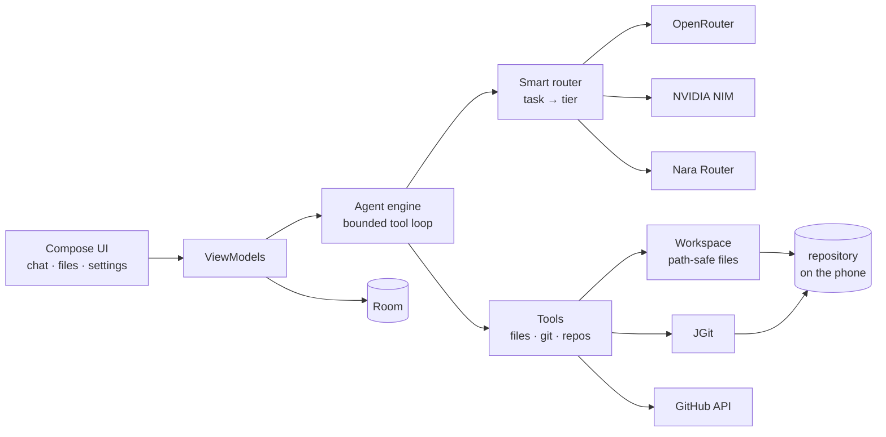

<div align="center">


<br/>

[](https://developer.android.com/about/versions/15)
[](https://kotlinlang.org)
[](https://developer.android.com/jetpack/compose)
[](LICENSE)

</div>

**Void** is a native Android AI coding agent. It clones one of your GitHub
repositories onto the phone, lets a model read and change the files through a
set of guarded tools, and commits and pushes the result. There is no server in
the middle: the only network peers are GitHub and the AI provider you choose.

<br/>

## What it does

| | |
|---|---|
| **Talks to your repository** | Real git through JGit — clone, status, diff, commit, push, branches. Not a mock. |
| **Edits like an agent** | Read, write, create, edit and search files, with the model choosing the tools. |
| **Asks before it destroys** | Deleting files and creating repositories wait for your tap. |
| **Hides the plumbing** | You pick a *tier*, never a provider's model name. |
| **Keeps everything on the phone** | Keys in the Android Keystore, TLS only, no analytics, no telemetry. |

<br/>

## Three tiers, not seven model names

The router reads the task and picks a tier. You can override it in Settings.

| Tier | When | Powers |
|---|---|---|
| **Red Dwarfs** | scaffolding, broad changes | strongest reasoning |
| **White Dwarfs** | reviews, refactors | balanced |
| **Neutron Stars** | explanations, small edits | smallest and fastest |

Under the hood — the app never shows these — the catalog is:

| Tier | Model | Provider |
|---|---|---|
| Red Dwarfs | `minimaxai/minimax-m3.1-flash` | NVIDIA NIM |
| White Dwarfs | `stepfun-ai/step-5-preview` | NVIDIA NIM |
| Neutron Stars | `nvidia/nemotron-3-ultra-550b-a55b` | OpenRouter |
| Neutron Stars | `poolside/laguna-xs-2.1` | NVIDIA NIM |
| Neutron Stars | `cohere/north-mini-code:free` | OpenRouter |

A model that fails or does not answer is skipped for the next one **in the same
tier** before the router ever moves down a tier. Every model call has a 45 s
budget; every tool call has its own.

<br/>

## How it is built



Ten Gradle modules: `core:{common, security, database, git, workspace, ai, agent}`,
`feature:{auth, repos, workspace, chat, settings}`, plus `designsystem` and `app`.
Kotlin 2.0, Compose, Hilt, Coroutines/Flow, Ktor, Room, JGit, kotlinx.serialization.

<br/>

## Status

Honest, as of the last commit:

| | |
|---|---|
| ✅ Built and unit-tested | 150 tests across all modules; both APKs assemble |
| ✅ Working | login, repo list, clone, file browser, git tools, agent loop, chat, settings |
| ⚠️ Unverified on a device | no phone or emulator was attached during development, so the three instrumented tests have only been compiled |
| ⚠️ Not configured yet | the OAuth client id (see below) and the Kira AI provider |

<br/>

## Build it

You need **JDK 21** and the **Android SDK with platform 35**.

```bash
# Linux / macOS
export JAVA_HOME=/path/to/jdk-21
export ANDROID_HOME=$HOME/Android/Sdk
./gradlew :app:assembleDebug
```

```powershell
# Windows
$env:JAVA_HOME = "C:\Program Files\Microsoft\jdk-21.0.13.21-hotspot"
$env:ANDROID_HOME = "$env:LOCALAPPDATA\Android\Sdk"
.\gradlew.bat :app:assembleDebug
```

The APK lands in `app/build/outputs/apk/debug/`.

### Sign in

Login uses GitHub's OAuth **device flow**, which needs an OAuth App with
Device Flow enabled and **no client secret**. Put its client id in
`local.properties` (gitignored — never commit it):

```properties
github.clientId=Ov23li...
```

Then build again. Without it, the login screen cannot complete.

<br/>

## Security

- **No backend.** Void has no service; the app talks to GitHub and the model
  provider directly.
- **Keys stay on the device.** Provider keys and the GitHub token live in
  `EncryptedSharedPreferences` (AES-256, Android Keystore), are read per
  request, and are never logged, never put in a URL, never committed.
- **Transport.** TLS 1.2/1.3 only, cleartext banned at the manifest level,
  certificate pinning wired and waiting for release pins.
- **Sign out wipes.** Token, provider keys, cached repositories and cloned
  workspaces are all deleted.
- **No telemetry.** No analytics, no crash reporting, no third-party SDKs.
  `INTERNET` is the only permission.

<br/>

## Roadmap

- [ ] On-device verification of the instrumented tests
- [ ] SQLCipher for the database at rest
- [ ] Biometric app lock, `FLAG_SECURE` on the editor
- [ ] Release pipeline with signed APKs and real certificate pins
- [ ] A model picker per provider, behind the tier names
- [ ] Kira AI provider

<br/>

## License

[MIT](LICENSE) © 2026 xyanncat

<div align="center"><sub>Built for a phone, not a terminal.</sub></div>
