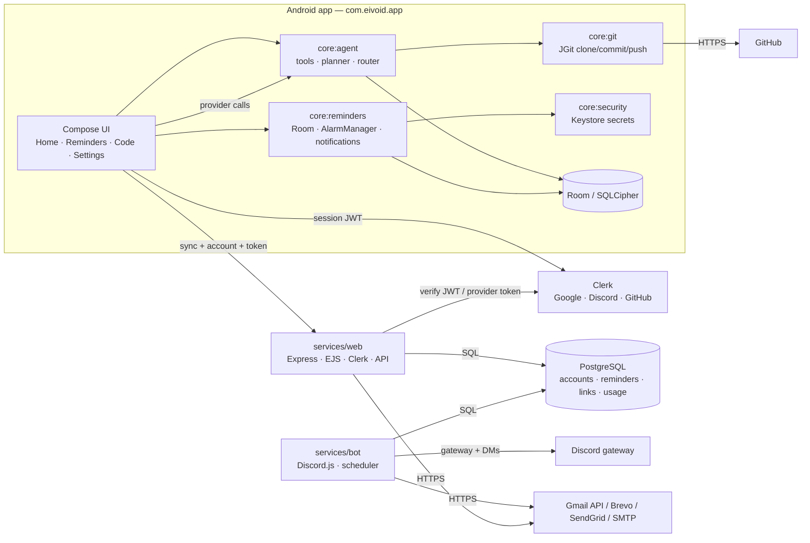
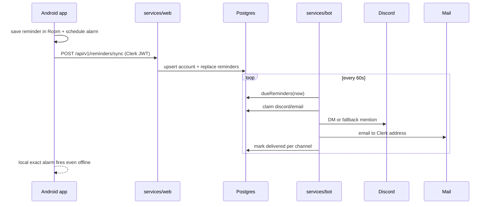

# Ei Void architecture

## Runtime responsibilities

| Component | Owns | Never holds |
|---|---|---|
| Android app | Reminder truth, alarms, agent loop, local secrets | Discord bot token, Clerk secret, mail credentials |
| `services/web` | Public pages, Clerk sessions, app API, GitHub token exchange, APK updates | Repository contents, prompts, AI keys |
| `services/bot` | Discord gateway, slash commands, reminder scheduler, DM/fallback delivery | Clerk session tokens, AI keys |
| Postgres | Account, reminder, link, device and usage state | Secrets, prompts, repository contents |

## Reminder delivery flow

## Security boundaries

- The Android app talks to Clerk directly and to the web API with a Clerk JWT.
- The web service verifies every JWT before reading or writing user data.
- The bot maps a Discord snowflake to an account; it never trusts a Clerk ID
  supplied by a caller.
- The bot token is only in the bot worker; the Clerk secret and mail credentials
  are only in web/bot environments.
- Device keys are hashed at rest and only carry usage counters.
- No service logs message content, email addresses or tokens.
